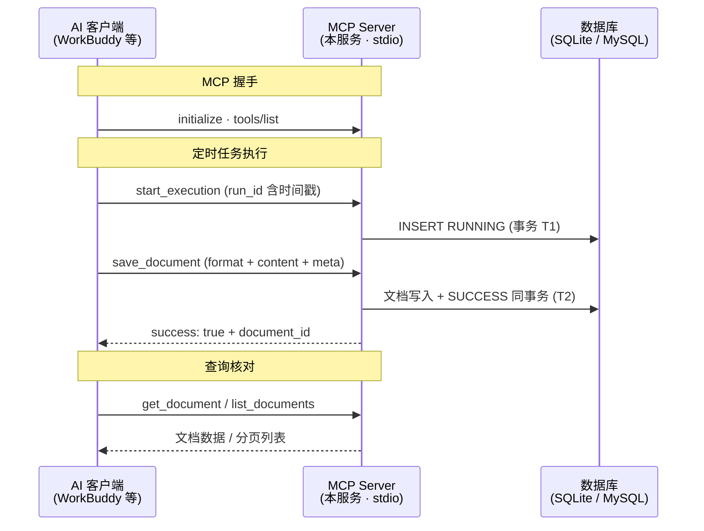

# km-data-sink-mcp

通用数据落库 MCP Server（V1.0.2）。任意支持 MCP 的 AI 客户端（WorkBuddy / Claude Desktop / Cursor / VS Code）可通过 stdio 调用，把采集/生成的 `.html` / `.md` 文档全文可靠保存到配置的数据库中。

- **技术栈**：Java 17+、MCP 官方 SDK 2.1.0（经典 server + stdio）、JDBC + HikariCP、YAML 配置驱动
- **数据库**：SQLite + MySQL（V1.0 正式支持；PostgreSQL / SQL Server 为 P2 扩展位）
- **不引入** Spring Boot / MyBatis / JPA

## 使用流程总览



一次完整的落库 = **MCP 握手 → start_execution 留痕 → save_document 写入（文档与执行状态同一事务）→ 查询核对**。`save_document` 是核心工具；其余工具用于连接确认、查询与排障。

## 用户上手四步

### 第 1 步：构建 jar

前置要求：JDK 17+、Maven。

```bash
mvn package
```

产出 `target/km-data-sink-mcp.jar`（fat jar，含全部依赖）。客户端只需要这个 jar + 一份 `config.yaml`，无需源码。

### 第 2 步：准备 config.yaml

复制 `config.yaml.example` 为 `config.yaml`，重点改三处。

**① 数据库连接**（落库到哪个库）：

```yaml
connections:
  default:
    type: mysql                  # 或 sqlite
    host: 你的数据库地址
    port: 3306
    database: 你的库名
    username: 你的账号
    password_env: SINK_DB_PASSWORD   # 注意：填环境变量的【名字】，不是密码本身
```

设置密码环境变量（Windows 示例）：

```powershell
[Environment]::SetEnvironmentVariable("SINK_DB_PASSWORD", "你的真实密码", "User")
```

> 常见坑：`password_env` 的值是环境变量名，程序读取该环境变量的值作为密码。填成密码本身会导致连接超时。

**② 白名单表**（"配置即 schema"，新增落库任务零代码）：

```yaml
tables:
  auto_create: true        # 表不存在自动建（并自动创建 created_at 排序索引）
  allowlist:
    - name: daily_report
      mode: overwrite      # overwrite=同键覆盖保留最新 / history=每次留痕
      columns:             # 每列：列名 / 类型 / 值来源 / 是否可空
        - column: task_name
          type: VARCHAR(128)
          source: task_name      # 从调用参数取
          nullable: false
        - column: title
          type: TEXT
          source: meta.title     # 从 meta 对象取（支持 meta.a.b 嵌套）
          nullable: true
        - column: content
          type: LONG_TEXT
          source: content        # 文档全文
          nullable: false
      upsert_key: [task_name, business_date, format]   # 唯一冲突判断键（单组，NOT NULL）
```

`source` 取值来源：`content` / `format` / `task_name` / `run_id` / `business_date` / `meta.xxx` / `system.uuid` / `system.now`。`document_id`、`created_at` 为系统强制列，不声明也自动加入。

**③ 其余配置保持默认即可**：`content.max_size_mb`（默认 5MB 超限拒绝）、`db.max_retry`（默认 3）、分页限制等均有合理默认。

### 第 3 步：接入 AI 客户端

WorkBuddy（`~/.workbuddy/mcp.json`）：

```json
{
  "mcpServers": {
    "km-data-sink-mcp": {
      "type": "stdio",
      "command": "java",
      "args": [
        "-jar",
        "D:/km-data-sink-mcp/target/km-data-sink-mcp.jar",
        "--config",
        "D:/km-data-sink-mcp/config.yaml"
      ]
    }
  }
}
```

Claude Desktop / Cursor / VS Code 配置一致（去掉 `type` 字段即可）。保存后客户端启动时会自动拉起本 Java 进程通过 stdio 通信，**无需手动运行**。

接入后 AI 客户端可见 7 个工具：

| 工具 | 使用时机 |
|---|---|
| `list_connections` / `test_connection` | 先确认连接可用 |
| `start_execution` | 定时任务**开始**时调用，创建执行留痕 |
| `save_document` | **核心**：文档落库 + 自动建表 + 执行状态同事务更新 |
| `get_document` / `list_documents` | 查回已落库文档 / 分页列表（不含全文） |
| `get_execution` | 查某次执行状态（RUNNING/SUCCESS/FAILED） |

### 第 4 步：定时任务提示词约定

在定时任务 prompt 中按以下约定写，AI 即可正确调用：

1. 任务开始先调 `start_execution`，`run_id = {任务名}_{业务日期}_{HHmmss}`（如 `daily_ai_news_20261119_150000`，含时间戳保证每次执行唯一）
2. 采集整理完数据后调 `save_document`：`format` 按内容指定 `html`/`md`，`content` 为完整文档，`meta` 放结构化元数据（映射到 `meta.xxx` 列）
3. **收到 `success: true` 才算保存成功**；失败时如实返回错误码（`CONTENT_TOO_LARGE` 内容超限 / `UNIQUE_KEY_CONFLICT` 辅助键冲突 / `INVALID_TABLE` 表不在白名单等）
4. 同一天重新生成用**新的 `run_id`**：`overwrite` 模式覆盖同日旧文档（只留最新），`history` 模式保留全部历史版本

**模式选择速查**：

| 场景 | 推荐 mode | upsert_key 示例 |
|---|---|---|
| 日报/周报，只要最新版 | `overwrite` | `[task_name, business_date, format]` |
| 采集记录，要留所有历史 | `history` | `[task_name, run_id, format]` |

### 验证与排查

- **快速验证**：`python scripts/e2e_test.py`（12 步端到端自动化）；或直接在客户端里让 AI"列出可用连接并测试连接"
- **看日志**：`logs/km-data-sink-mcp.log`（日志走 stderr 与文件，绝不污染 stdio 协议通道）
- **查执行历史**：`mcp_task_execution` 表记录每次执行的 RUNNING/SUCCESS/FAILED 与错误信息——排查定时任务是否真正成功的最可靠依据
- **已有旧表补排序索引**（新表自动创建，旧表不自动 ALTER）：
  ```sql
  CREATE INDEX IF NOT EXISTS idx_order_by_表名 ON 表名 (created_at);   -- SQLite
  CREATE INDEX idx_order_by_表名 ON 表名 (created_at);                  -- MySQL
  ```

## 核心特性

| 特性 | 说明 |
|---|---|
| 配置即 schema | 数据库连接、表结构、字段来源、类型、唯一键全部 YAML 声明，新增任务类型无需改代码 |
| 幂等 upsert | 单组 `upsert_key` 先查后写；辅助 `unique_keys` 冲突即拒绝（`UNIQUE_KEY_CONFLICT`） |
| 执行记录 | `mcp_task_execution` 表（每连接独立），RUNNING / SUCCESS / FAILED 全程留痕 |
| 事务一致性 | T1（RUNNING）/T2（文档+SUCCESS）/T3（FAILED）事务边界明确，失败不留半条数据 |
| document_id | 服务端 UUID 生成（VARCHAR(36)），overwrite 模式更新保留原值 |
| 内容限制 | 单篇文档上限 `content.max_size_mb`（默认 5MB，UTF-8 字节），超限拒绝不截断 |
| SQLite 并发 | 单进程连接池强制 1；多进程靠 WAL + busy_timeout + 有限重试缓解（多进程压测 180/180 通过） |
| 安全 | 表/列白名单、参数化绑定、排序字段白名单、密码环境变量注入、错误信息脱敏 |
| 查询性能 | list_documents 两段查询 + 按需 COUNT + created_at 索引（实测 p50 212ms → 37ms） |

## MCP 工具（7 个）

| 工具 | 作用 |
|---|---|
| `start_execution` | 创建/重置任务执行记录（RUNNING，独立事务） |
| `save_document` | 文档落库 + 自动建表 + 执行记录更新（同事务） |
| `get_document` | 按 `document_id` 或完整 `upsert_key` 查回完整文档 |
| `list_documents` | 分页查询文档列表（不含全文，只返回摘要 + 元数据） |
| `get_execution` | 查询任务执行记录 |
| `test_connection` | 测试连接，返回类型 + 版本 |
| `list_connections` | 列出可用连接名（脱敏） |

所有工具返回统一信封：`{success, code, message, data}`；业务失败返回 `isError(true)` 的 tool result，不向客户端抛异常。

### 错误码

`SUCCESS` / `INVALID_ARGUMENT` / `INVALID_CONNECTION` / `INVALID_TABLE` / `INVALID_COLUMN` / `INVALID_QUERY_CONDITION` / `NON_UNIQUE_RESULT` / `UNIQUE_KEY_CONFLICT` / `CONTENT_TOO_LARGE` / `DOCUMENT_NOT_FOUND` / `EXECUTION_ALREADY_RUNNING` / `EXECUTION_ALREADY_SUCCESS` / `EXECUTION_NOT_FOUND` / `DATABASE_CONNECTION_ERROR` / `DATABASE_TRANSACTION_ERROR` / `DATABASE_LOCK_TIMEOUT` / `SCHEMA_VALIDATION_FAILED` / `INTERNAL_ERROR`

## 测试与压测

```bash
mvn test                                # 全量：SQLite 集成 26 例 + 方言单元 16 例
mvn test -Dtest=MySqlIntegrationTest    # MySQL 集成（需设 SINK_MYSQL_TEST=1 及连接环境变量）
python scripts/e2e_test.py              # stdio 端到端 12 步断言
python scripts/stress_test.py           # 压测：A=SQLite 单进程 B=多进程并发 C=MySQL（B/C 说明见脚本头注释）
```

压测参考结果（本机实测）：

| 阶段 | 场景 | 结果 |
|---|---|---|
| A | SQLite 单进程 8KB 文档写入 | 123–303 ops/s，p50 3–6ms |
| A | 5MB 大文档 | 成功落库；超限 150ms 快速拒绝 |
| B | 6 进程并发 ×30 写（WAL + 重试） | 180/180 成功，数据一致 |
| C | 远程 MySQL | 需数据库可达后运行 |

## 日志

日志只写 `System.err` 与 `logs/km-data-sink-mcp.log`，绝不污染 `System.out`（stdio 协议通道）。
